# Strava Clone — System Map

> [!abstract] What this file is
> A **complete mental model of this repository** — written so you can answer almost any
> "how does X work / where does X live / why is X like that" question **without opening a source file**.
>
> It is a *map*, not a spec. It captures intent, invariants, and gotchas. When code and this
> document disagree, **the code is truth** — update this file.
>
> Companion docs: [[ROADMAP]] (what to build next) · [[PersonalNotes]] (scratch list)

---

## Table of Contents

- [[#1. The one-paragraph version]]
- [[#2. Repository layout]]
- [[#3. Monorepo mechanics — the thing that surprises everyone]]
- [[#4. Package dependency graph]]
- [[#5. The database]]
- [[#6. The core idea — one activity shape, three sources]]
- [[#7. Path A — GPX upload (web)]]
- [[#8. Path B — Manual entry (web + mobile)]]
- [[#9. Path C — GPS recording (mobile)]]
- [[#10. `@repo/gpx` — the GPS math library]]
- [[#11. `@repo/units` — conversions & formatting]]
- [[#12. `@repo/validation` — Zod schemas]]
- [[#13. Auth & sessions, end to end]]
- [[#14. `apps/web` — routes, data fetching, components]]
- [[#15. `apps/mobile` — routes, recorder, storage]]
- [[#16. `apps/tile-provider` + `@repo/maps` — self-hosted tiles]]
- [[#17. Environment variables]]
- [[#18. Commands & tooling]]
- [[#19. Deployment]]
- [[#20. Invariants — do not break these]]
- [[#21. Known gaps, bugs & sharp edges]]
- [[#22. Glossary]]
- [[#23. File index — "where do I look?"]]

---

## 1. The one-paragraph version

This is a **pnpm monorepo** containing a **Strava clone** with three deployables: a **Next.js 16 web app** (`apps/web` — which is *also* the entire backend: API routes + auth handler), an **Expo/React Native app** (`apps/mobile`), and a **standalone vector-tile HTTP server** (`apps/tile-provider`). Seven shared **workspace packages** (`packages/*`) hold all the real logic — database access, GPX/geometry math, unit conversion, Zod validation, shared types, and the MapLibre style/provider registry. A user records or uploads an activity, the client posts it to **`POST /api/activities`**, a **source-specific normalizer** converts it into one canonical shape, and it is written to **Postgres in a single transaction** alongside a row of `jsonb` chart streams. Everything displayed — maps, elevation profiles, pace — is derived from a **Google-encoded polyline** and those four numeric arrays. The server owns all derived metrics; the mobile app is a thin sensor client.

> [!tip] The three sentences that explain 90% of the codebase
> 1. **All three activity sources converge on `NormalizedActivityData`** before touching the database. (`apps/web/lib/normalization/`)
> 2. **Stats and chart streams are always computed from RAW points; only the drawn polyline is simplified.** This is why the chart is high-resolution and the route is cheap.
> 3. **Distance, duration and elevation are always stored in integer metres / integer seconds.** Everything else converts for display.

---

## 2. Repository layout

```text
Strava-clone/
├── apps/
│   ├── web/                  Next.js 16 — web UI + ALL backend (API + auth)
│   │   ├── app/              App Router: pages, layouts, API route handlers
│   │   ├── components/       Navbar, ActivityFeed/Card, map/, charts/, onBoardingUI/
│   │   ├── lib/              auth.ts, auth-client.ts, normalization/
│   │   ├── proxy.ts          Next 16 middleware (route gating)
│   │   └── next.config.ts    output: standalone, transpilePackages
│   │
│   ├── mobile/               Expo SDK 57 — iOS/Android client
│   │   ├── src/app/          expo-router file routes (groups: (auth) (onboarding) (app))
│   │   ├── src/components/   Map, charts/, ui/ (recorder, activity, onboarding), ui/
│   │   ├── src/hooks/        useActivityRecorder, useActivities, useOnboarding
│   │   ├── src/lib/          locationTask, activeSessionStorage, activityStorage, auth-client
│   │   └── android/          Prebuild output (committed); no ios/ directory
│   │
│   └── tile-provider/        Cpeak HTTP server over one .mbtiles file
│       ├── src/              index (boot), server, env, routes/{tiles,system}
│       └── data/             south-india.mbtiles (446 MB) + tilemaker config/process.lua
│
├── packages/                 7 shared libraries — raw TypeScript, no build step
│   ├── db/                   Drizzle schema, pg pool, query functions, migrations
│   ├── gpx/                  GPX parse, haversine, polyline codec, Douglas-Peucker, stats, streams
│   ├── units/                distance/elevation/speed/pace/duration/date conversions
│   ├── validation/           Zod schemas (activity types derived from the DB enum)
│   ├── types/                shared DTO types derived from Drizzle
│   ├── maps/                 tile provider registry + MapLibre style adapters
│   └── tiles/                read-only MBTiles (SQLite) reader for the tile server
│
├── Dockerfile                3-stage: deps → build → standalone runner
├── biome.json                formatter (tabs, double quotes) + linter  ← the real linter
├── pnpm-workspace.yaml       apps/*, packages/*, allowBuilds for native modules
├── ROADMAP.md                what to build next
└── PersonalNotes.md          scratch todo
```

---

## 3. Monorepo mechanics — the thing that surprises everyone

> [!warning] There is no build step for any package
> Every `packages/*/package.json` points `main`, `types` and `exports` at **raw TypeScript source**:
> ```json
> { "main": "./src/index.ts", "types": "./src/index.ts", "exports": { ".": "./src/index.ts" } }
> ```
> There is no `tsc -b`, no `dist/`, no `turbo`, no `nx`. **Next.js and Metro compile the `.ts` files directly.**

**What this means in practice:**

| Concern | Reality |
|---|---|
| Editing a package | Change is hot — no rebuild, no restart |
| `transpilePackages` | `apps/web/next.config.ts` lists `@repo/db`, `@repo/gpx`, `@repo/types`, `@repo/validation`, `@repo/units`. **`@repo/maps` is missing** and only works because `pnpm web` runs `next dev --webpack`. |
| Path aliases | `apps/web/tsconfig.json` aliases only `@repo/db` and `@repo/validation`. Everything else resolves through pnpm's `node_modules` symlinks. |
| `tsconfig` inheritance | `tsconfig.base.json` (strict) → `tsconfig.node.json` (NodeNext) for packages & mobile-adjacent, → `tsconfig.react.json` (Bundler, ES2017) for web. `packages/maps` is the odd one out: it uses `base` + `moduleResolution: "bundler"` because it is browser-targeted. |
| Linting | **Biome is the real linter** (`pnpm lint` → `biome lint`, tab indent). `apps/web` additionally has an unused `eslint.config.mjs` + `eslint` script. Two formatters, hence mixed indentation on disk. |
| Tests | **There are none.** `pnpm test` deliberately exits 1. |
| Build/Docker | Only `apps/web` is built (`next build` → `.next/standalone`). Mobile and tile-provider are run from source (`expo start`, `tsx src/index.ts`). |

### TypeScript config chain

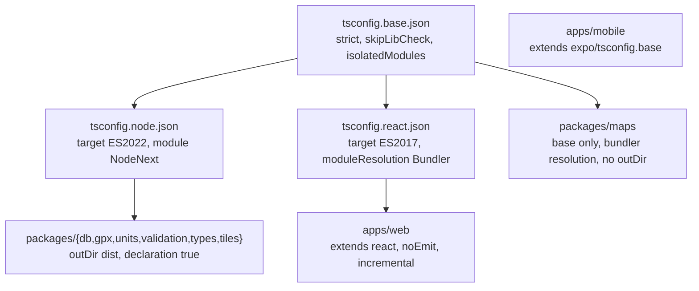

---

## 4. Package dependency graph

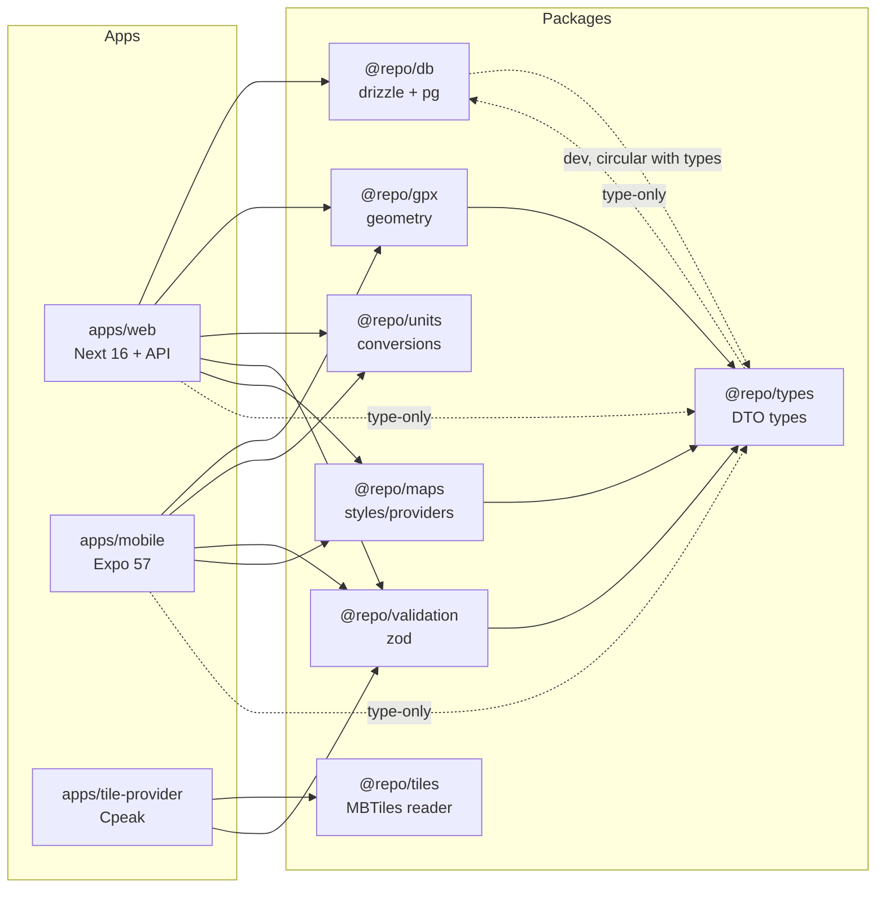

> [!note] The circular `@repo/db` ⇄ `@repo/types` dev-dependency
> `@repo/db` devDepends on `@repo/types`; `@repo/types` devDepends on `@repo/db`. Every import across
> that edge is `import type`, so nothing from `pg`/`drizzle-orm` ever reaches a client bundle.
> This is how `@repo/types` can derive its types **from the Drizzle schema** without pulling in Postgres.

### Who owns what

| Package | Owns | Never does |
|---|---|---|
| `@repo/db` | Schema, migrations, pg pool, 8 query functions | Validation, business rules, HTTP |
| `@repo/gpx` | All geometry & time-series math | DB, HTTP, units display |
| `@repo/units` | Pure conversion + formatting | IO, DB, React |
| `@repo/validation` | Zod schemas; re-exports `ZodError` | Normalization, DB |
| `@repo/types` | Type aliases only (zero runtime) | Any logic |
| `@repo/maps` | Provider registry, style builders, tile-server URL | Network calls, DB |
| `@repo/tiles` | Read-only MBTiles access + XYZ↔TMS math | Serving HTTP, writing tiles |

---

## 5. The database

**Engine:** PostgreSQL (Neon, pooled `DATABASE_URL` at runtime; unpooled `DATABASE_URL_DIRECT` for Drizzle Kit migrations).
**Access:** `pg` `Pool` → `drizzle-orm/node-postgres`.
**Location:** `packages/db/src/{db,schema,index}.ts`, `packages/db/src/queries/*.ts`.

```ts
// packages/db/src/db.ts — the entire connection layer
const pool = new Pool({ connectionString: process.env.DATABASE_URL })
export const db = drizzle(pool, { schema })   // `schema` unlocks db.query.* relations
```

### Table map

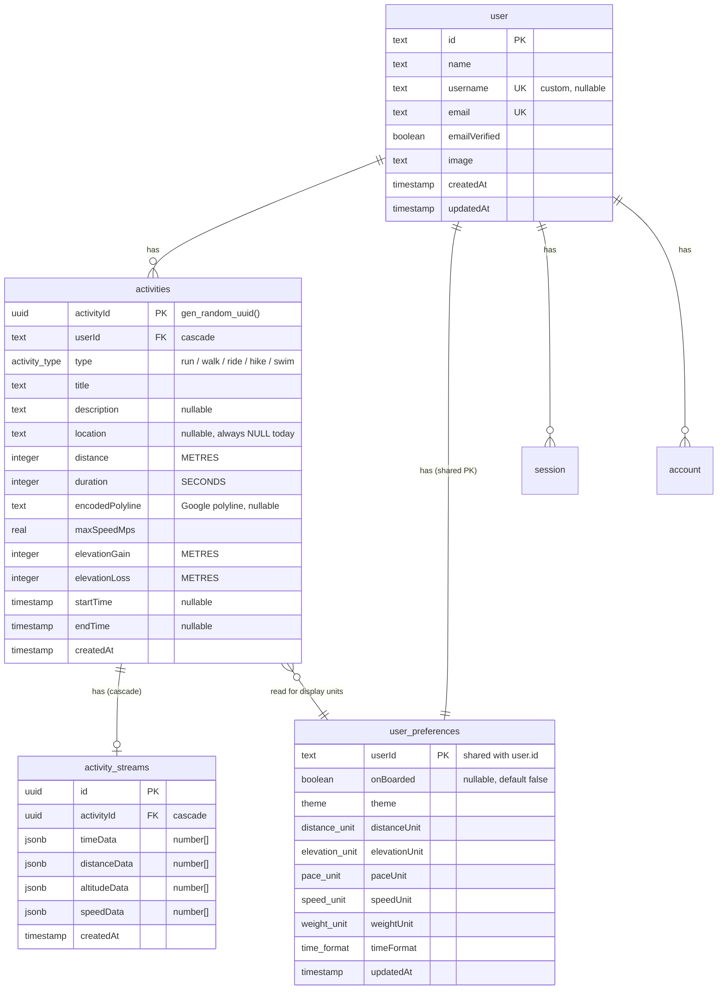

> [!important] Design decisions encoded in the schema
> - **`activity_streams` has no coordinates.** The route geometry lives *only* in `activities.encodedPolyline`. Four `jsonb` arrays hold the chart series. Chosen deliberately: *"efficient for bulk reads, no joins needed"*.
> - **No latitude/longitude columns at all.** The polyline is the geometry.
> - **`user_preferences.userId` is the primary key**, not a surrogate + unique — the standard Drizzle one-to-one pattern.
> - **No indexes anywhere in the entire schema.** Every `findMany` is a sequential scan. Fine at MVP scale; see [[#21. Known gaps, bugs & sharp edges]].
> - **All timestamps are `timestamp` (no time zone)** — i.e. naive. Formatters that use `toISOString()` therefore display UTC.

### Migration history

| # | File | What it did |
|---|---|---|
| 0000 | `0000_dry_gamora.sql` | 5 enums + 7 tables + 5 FKs. `activities.type` was plain `text`. |
| 0001 | `0001_high_stepford_cuckoos.sql` | Added `pace_unit` and `speed_unit` enums + columns. |
| 0002 | `0002_legal_mongoose.sql` | Added nullable `on_boarding boolean default false`. |
| 0003 | `0003_empty_sir_ram.sql` | Added `user.username` (nullable) + `UNIQUE`. |
| 0004 | `0004_past_lady_ursula.sql` | Created the `activity_type` enum; `ALTER COLUMN type SET DATA TYPE activity_type USING type::activity_type`; renamed `on_boarding` → `on_boarded`. |

> [!warning] Migration 0004 is not backfill-safe
> The `text → enum` cast throws if any pre-existing row has a `type` outside the five labels
> (e.g. a legacy `"Other"`). Clean the data first or the whole migration aborts.

### The query layer — 8 functions

**`queries/activities.ts`**
- `getActivitiesByUser(userId, limit = 5, offset = 0)` — `user ⋈ activities` join (only to fetch `user.name`), `ORDER BY created_at DESC`. Returns `[]`, never null.
- `getActivityDetails(activityId)` — `db.query.activities.findFirst` with `with: { streams: true, user: { with: { preferences: true } } }`. Returns `activity | undefined`. **Four separate round-trips, not one JOIN.**
- `CreateActivity(data, streams?)` — ⭐ **the only transactional function.** Inserts the activity, then the streams row, in one `db.transaction`, linking via the `RETURNING`-generated `activityId`.
- `DeleteActivity(activityId, userId?)` — ⭐ **`userId` is the entire authorization model.** Pass it → `WHERE activity_id = $1 AND user_id = $2`. Omit it → anyone can delete anything. Returns `{ id } | null`. Stream row is removed by FK cascade.

**`queries/uploads.ts`** (legacy, non-transactional)
- `CreateActivityFromGpx(data)` — whitelist re-projection of the insert; drops `location`/`createdAt` so they take DB defaults.
- `CreateActivityStreams({ activityId, streams })` — inserts the four arrays, returns `void`.

**`queries/preferences.ts`**
- `createUserPreferences(userId)` — `INSERT ... ON CONFLICT DO NOTHING RETURNING *`; if zero rows came back (conflict), fall through to a `SELECT`. **Idempotent**, so it is safe to call on every dashboard load. Returns `preferences | undefined`.
- `getUserPreferences(userId)` — `preferences | undefined`.
- `updateUserPreference(userId, data)` — ⚠️ `data` is typed as the **full** `preferencesType`, not `Partial<>`; callers must merge. Returns the **array** from `.returning()` (routes do `updated[0] ?? updated`).

**`queries/users.ts`**
- `getUserByUsername(username)` — `user | null`.
- `updateUserUsername(userId, username)` — returns the updated row or `undefined`; throws (23505) on a unique violation.

---

## 6. The core idea — one activity shape, three sources

> [!tip] This is the single most important section in this document
> A GPX file, a typed-in form, and a phone recording are wildly different inputs.
> The **entire backend** exists to flatten them into one shape so the database doesn't care where
> a row came from.

### The canonical shape

```ts
// apps/web/lib/normalization/shared.ts
export type NormalizedActivityData = {
  type: ActivityTypes          // "run" | "walk" | "ride" | "hike" | "swim"
  title: string
  description: string | null
  location: string | null      // always null — no geocoder exists
  distance: number             // METRES, integer (column is `integer`)
  duration: number             // SECONDS, integer
  elevationGain: number        // METRES, integer
  elevationLoss: number        // METRES, integer
  encodedPolyline: string | null
  maxSpeedMps: number | null
  startTime: Date | null
  endTime: Date | null
  streams: ActivityStreams | null   // { timeData, distanceData, altitudeData, speedData }
}
```

> [!note] Why `null` and not `undefined` here
> `null` means *"genuinely absent"*. The route handler then collapses `null → undefined` so Drizzle
> **omits the column** (letting `DEFAULT now()` apply) rather than writing an explicit SQL `NULL`.

### The 12-step server pipeline

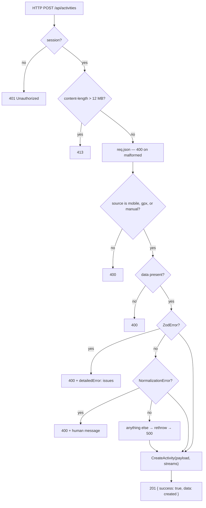

The three-way error taxonomy (`apps/web/app/api/activities/route.ts`) is the most deliberate design in the codebase:

| Error class | Meaning | Response |
|---|---|---|
| `ZodError` | The client sent bad data | `400 { error, detailedError: err.issues }` — field-level, consumed by the forms' `formatErrorMessage` |
| `NormalizationError` | Well-formed but semantically unusable (e.g. GPX with no points) | `400 { error: err.message }` |
| Anything else | **Our bug** | Rethrown → outer catch → generic `500` |

> [!important] The one place ownership is enforced correctly
> `const userId = session.user.id` — the POST handler takes `userId` **from the session, never from
> the body**. A client cannot create an activity for another user. (Contrast with `GET`, which does
> not do this — see [[#21. Known gaps, bugs & sharp edges]].)

### Where each field comes from, per source

| Field | GPX (web) | Manual (web + mobile) | Mobile recorder |
|---|---|---|---|
| `distance` | `computeStats().totalDistanceMeters` (haversine sum) | `distanceToMeters(input, unit)` | **client-sent** `distanceMeters` |
| `duration` | last.timestamp − first.timestamp | `durationToSeconds({hr,min,sec})` | **client-sent** `durationSeconds` |
| `elevationGain/Loss` | `computeStats()` w/ **2 m noise threshold** | `elevationToMeters(input, unit)` | **server-recomputed** from points |
| `maxSpeedMps` | `computeStats().maxSpeedMps` | `null` | client value, else recomputed |
| `encodedPolyline` | `encodePolyline(douglasPeucker(pts, 0.0001))` | `null` | same, from `points[]` |
| `streams` | `buildStreams(rawPoints)` | `null` | `buildStreams(rawPoints)` |
| `startTime`/`endTime` | from the file — **may be null** | `startTime ?? new Date()` | `new Date(startedAt/endedAt)` |

> [!tip] The asymmetry is intentional
> **GPX derives everything from the file. Mobile trusts the recorder's own totals and only *adds*
> derived geometry. Manual converts units and invents nothing.** Each normalizer's doc comment says so.

### The shared coercion helpers

`apps/web/lib/normalization/shared.ts` exists so nothing can ever write `NaN` or `Invalid Date` into Postgres:

| Helper | Guarantee |
|---|---|
| `toNonNegativeInt(v)` | finite, > 0 → `Math.round(v)`; anything else → `0` |
| `toNullableNumber(v)` | finite, ≥ 0 → `v`; anything else → `null` |
| `toNullableText(v, max)` | trim → empty becomes `null` → `slice(0, max)` |
| `toValidDate(v)` | `new Date(v)`, or `null` if `NaN`-timestamped |
| `MAX_TITLE_LENGTH` | `100` |
| `MAX_DESCRIPTION_LENGTH` | `1000` |

---

## 7. Path A — GPX upload (web)

**Entry point:** `apps/web/app/upload/file/page.tsx` (client) → `POST /api/activities`.

> [!important] The file is read **in the browser** and sent as a JSON string
> `const xmlContent = await file.text()` — it is **not** `multipart/form-data`.
> That is why the 10 MB Zod limit is measured in *JS string length*, and why the route has a
> 12 MB `content-length` cap.

**Wire format:**
```json
{ "source": "gpx", "data": { "title": "…", "description": null, "xmlContent": "<?xml …" } }
```
Note `type` is **never sent** — `GpxActivitySchema` has `.default("run")`, so **every web GPX upload is typed `run`**.

### The pipeline, step by step

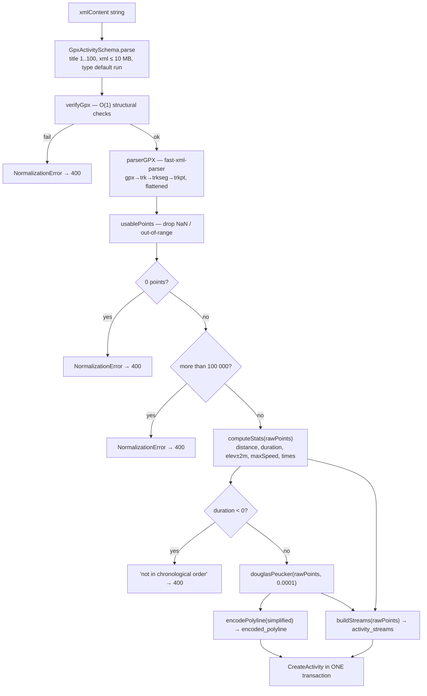

### `verifyGpx` — the cheap pre-parse gate

Runs **before** `fast-xml-parser` so a junk 10 MB file is rejected without allocating an object graph. O(1) with respect to file size:

1. `xmlString.length > 10_000_000` → fail
2. `xmlString.slice(0, 1024)` must contain `"<gpx"`
3. `xmlString.indexOf("<trkpt")` must be `!== -1`
4. A 200-char window around the first `<trkpt` must match `/lat\s*=\s*["']([^"']+)["']/` and the `lon` equivalent, both parse-finite and in range

Returns a discriminated union — **not** a throw:
```ts
type GpxVerificationResult = { ok: true } | { ok: false; reason: string }
```
The caller re-throws as `NormalizationError`, so `reason` becomes the user-facing text.

> [!warning] These are substring checks, not XML parsing
> - A namespaced file (`<ns:gpx>`, `<ns:trkpt>`) **fails checks 2 and 3**.
> - A `<gpx` inside an XML comment in the head **passes** check 2.
> - Only the *first* `<trkpt>` is coordinate-validated; the rest are `parserGPX`'s problem.
> - There is **no well-formedness check** — a file that passes all four can still make `parserGPX` throw.

### `parserGPX` configuration that matters

```ts
new XMLParser({
  ignoreAttributes: false,                        // lat/lon live in XML *attributes*
  attributeNamePrefix: "@_",                      // why the code reads pt["@_lat"]
  isArray: (name) => ["trkpt", "trk", "trkseg"].includes(name),  // force arrays
})
```

> [!tip] Why `isArray` is load-bearing
> Without it `fast-xml-parser` returns a **bare object** for a single-element list, and `for…of`
> over it throws. This one line is what makes single-point GPX files parse.

**Other behaviours:** only `<trk>` is read (`<rte>`/`<wpt>` ignored). All tracks/segments are **flattened into one array** — segment boundaries (which imply pauses) are lost and distance runs straight through them. `<gpx><metadata><name>` is **not** read; the title always comes from the request body. `parseFloat(undefined)` yields `NaN` — which is exactly what `usablePoints()` filters out.

---

## 8. Path B — Manual entry (web + mobile)

**Web:** `apps/web/app/upload/manual/page.tsx` → `POST /api/activities`.
**Mobile:** `apps/mobile/src/app/(app)/upload/manual.tsx` → same endpoint.

**Wire format:**
```json
{
  "source": "manual",
  "data": {
    "title": "…", "description": "…", "type": "run",
    "distance": 5.2, "duration": { "hr": 0, "min": 30, "sec": 0 },
    "elevationGain": 40, "elevationLoss": 20,
    "startTime": "2026-09-25T07:30", "endTime": null,
    "metaData": { "distanceUnit": "metric", "elevUnitGain": "meters", "elevUnitLoss": "meters" }
  }
}
```

### `normalizeManualActivity` — conversion only

```ts
const distanceMeters = distanceToMeters(parsed.distance, distanceUnit)
const durationSeconds = typeof parsed.duration === "number"
  ? parsed.duration
  : durationToSeconds(parsed.duration)
const elevationGain = elevationToMeters(parsed.elevationGain, elevUnitGain)
const elevationLoss = elevationToMeters(parsed.elevationLoss, elevUnitLoss)
const startTime = toValidDate(parsed.startTime) ?? new Date()   // logging it now → "now" is honest
const endTime = parsedEndTime && parsedEndTime.getTime() >= startTime.getTime()
  ? parsedEndTime : null
```

Returns `encodedPolyline: null, maxSpeedMps: null, streams: null, location: null` — *"There is no track, so no polyline, no streams and no derived speed."*

**Notes:**
- `duration` is a **union**: `number` (seconds) **or** `{hr,min,sec}`. Mobile sends the object, the web form sends the object, a hypothetical numeric client would work.
- `elevUnitGain` and `elevUnitLoss` are **independent**, so gain and loss can be entered in different units in one form.
- The Zod schema *also* `.refine`s `endTime >= startTime`; the normalizer re-checks it. Belt and braces.
- Manual entry does **not** write to mobile local storage — it goes straight to the server.

---

## 9. Path C — GPS recording (mobile)

This is the most involved flow in the codebase. Four files cooperate:

```text
lib/locationTask.ts        ← native background task + pub/sub fan-out
lib/activeSessionStorage.ts ← AsyncStorage buffer + incremental distance math
hooks/useActivityRecorder.ts ← React state machine projecting the session
app/(app)/recorder/recorder.tsx ← the screen
```

### The architecture: storage is the source of truth

> [!important] React state is only a **projection** of AsyncStorage
> This is the design decision that makes background recording, process death, and recovery all work
> for free. The hook never computes distance — it **reads it back** from storage, so there is exactly
> one implementation of the distance math.

### The point shape

```ts
// @repo/types
type ActivityPoint = {
  latitude: number; longitude: number
  altitude: number | null; speed: number | null; accuracy: number | null
  timestamp: number          // epoch MILLISECONDS
}
```

Validation, applied at three separate points (background task, `appendPointsToActiveSession`, `handleLivePoint`):
```ts
isValidLocationPoint = (p) => !(p.accuracy !== null && p.accuracy > 100)
                        && !(p.latitude === 0 && p.longitude === 0)
```
Drops GPS fixes worse than 100 m and null-island fixes.

### The session object

```ts
// AsyncStorage key: "@strava_clone_active_session_v1"
type ActiveSession = {
  id: string                    // `act_${Date.now()}`
  type: ActivityTypes
  status: "recording" | "paused"
  startedAt: number             // epoch ms
  pausedAt: number | null
  totalPausedMs: number
  distanceMeters: number
  currentSpeedMps: number
  maxSpeedMps: number
  points: ActivityPoint[]
  isBackgroundActive: boolean
}
```

### The background task

```ts
// expo-task-manager, accuracy BestForNavigation
{
  timeInterval: 2000,  distanceInterval: 2,        // immediate delivery
  deferredUpdatesInterval: 2000, deferredUpdatesDistance: 2,  // batched delivery
  showsBackgroundLocationIndicator: true,
  pausesUpdatesAutomatically: false,
  foregroundService: { /* Android: "Recording Activity" notification, #FC5200 */ }
}
```

`TaskManager.defineTask` **does double duty**: it validates + **persists** each point *and* fans it out to in-app listeners, so the live UI updates even though the task was started by the OS headlessly.

### The buffering + distance math

```ts
async function appendPointsToActiveSession(newPoints) {
  const session = await getActiveSession()
  if (!session || session.status !== "recording") return null   // ← pause is implemented HERE

  for (const point of newPoints) {
    if (!isValidLocationPoint(point)) continue
    if (last && last.latitude === point.latitude
             && last.longitude === point.longitude
             && last.timestamp === point.timestamp) continue     // exact-triple dedup
    if (point.speed !== null && point.speed >= 0)
      updatedMaxSpeed = Math.max(updatedMaxSpeed, point.speed)
    if (last) {
      const d = haversineDistance(last.lat, last.lng, point.lat, point.lng)
      if (d > 0.5) updatedDistance += d        // 0.5 m floor kills stationary jitter
    }
    last = point
  }
  if (!modified) return session   // skip the AsyncStorage write entirely
}
```

> [!tip] Pause is a **storage-layer** concept
> Pausing does **not** stop the OS task. The task keeps firing; points are silently **discarded** by
> the `status !== "recording"` guard. That is why pause is implemented here and not in the hook.

### Foreground/background arbitration

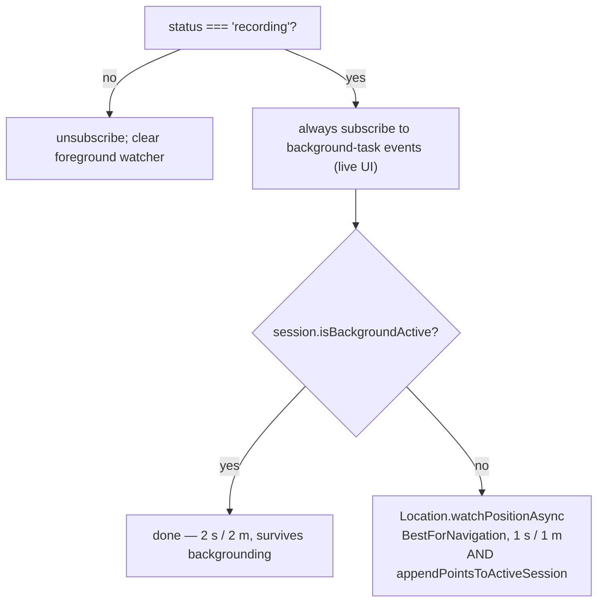

`isBackgroundActive` is captured **once at `startRecording` and never re-probed**. If the OS task dies
mid-activity, the UI silently stops updating — a known rough edge.

### Three sync paths (why recovery works)

1. **Hydrate on mount** — `getActiveSession()` → `syncFromSession()`
2. **Re-sync on foreground** — `AppState` `"active"` → re-read from disk
3. **1 Hz ticker** — recomputes *only* `elapsedSeconds` from `sessionRef.current`, never re-reads storage

Plus a root-layout `cleanupStaleLocationTasks()` on mount, which kills orphaned background tasks left
behind by a crash/force-kill.

### Elapsed time excludes pauses

```ts
computeElapsedSeconds(session) =
  Math.max(0, Math.floor((now_or_pausedAt - startedAt - totalPausedMs) / 1000))
```

### Saving

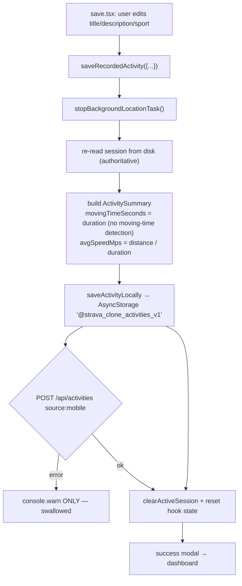

> [!danger] The biggest durability gap in the mobile app
> The server POST failure is caught with a `console.warn` and **forgotten**. The activity is in local
> AsyncStorage, the user sees success, and there is **no retry queue, no outbox, no reconciliation
> pass**. Nothing ever calls `getSavedActivitiesLocally()` — it is a **write-only archive**. A failed
> sync means a permanently un-synced activity.

### Mobile activity list caching

`hooks/useActivities.ts` keeps a **module-level** cache (`cachedUserId` / `cachedActivities`) so tab
switches don't refetch, plus a `deleteListeners` set so a delete on the detail screen instantly
updates every mounted feed. `invalidateActivitiesCache()` is called after manual upload.

---

## 10. `@repo/gpx` — the GPS math library

Pure computation. One runtime dependency: `fast-xml-parser`. Used by **both** web (server) and mobile.

### The internal point shape

```ts
// Deliberately uses GPX's own abbreviated field names so a parsed point is
// a drop-in for a hand-built one.
type RawTrackpoint = { lat: number; lng: number; ele: number | null; time: Date | null }
```

> [!note] Name inversion to watch for
> `ActivityPoint` (client-facing, `@repo/types`) uses `latitude`/`longitude`/`altitude`/`timestamp`.
> `RawTrackpoint` (internal) uses `lat`/`lng`/`ele`/`time`.
> `apps/web/lib/normalization/mobile.ts` is where the conversion happens.

### `haversineDistance(lat1, lng1, lat2, lng2)` — metres

```ts
const EARTH_RADIUS_METERS = 6_371_000        // IUGG mean radius
a = sin²(Δφ/2) + cosφ₁·cosφ₂·sin²(Δλ/2)
c = 2 · atan2(√a, √(1−a))                    // atan2 → no domain error at a = 1
return EARTH_RADIUS_METERS * c
```
Worst-case error vs. WGS-84 authalic radius ≈ **0.3%**. Full float precision; **rounding happens in the callers**.

### `encodePolyline` / `decodePolyline` — Google Encoded Polyline Format 1.0

Implemented from scratch, **precision 1e-5** (≈ 1.1 m of latitude):

1. `Math.round(coord * 1e5)`
2. delta from the previous rounded value (starting from `0,0`)
3. zigzag: `v < 0 ? ~(v << 1) : v << 1` (negatives → odd, non-negatives → even)
4. split into 5-bit chunks, set continuation bit `0x20` on all but the last
5. add ASCII offset 63, arithmetic `>>= 5`

> [!important] The polyline is **the only geometry stored in Postgres**
> `encode → encoded_polyline text → decode` is the entire round-trip. `activity_streams` has no
> coordinates. This is why `encodedPolyline` is nullable: manual entries have no route.

**Edge cases:** empty array → `""` (both normalizers guard with `|| null`). `decodePolyline("")` → `[]`. A truncated polyline silently decodes a garbage trailing coordinate rather than throwing.

### `douglasPeucker(points, epsilon = 0.0001)` — route simplification

- **Epsilon is in raw degrees.** `0.00001` ≈ 1 m · `0.0001` ≈ 10 m *(the project default)* · `0.001` ≈ 100 m.
- Uses a **true perpendicular point-to-segment distance** (the `t` parameter is clamped to `[0,1]`), which is the correct modern formulation.
- `length <= 2` returns the input **by reference**. Strict `>` against epsilon. Recursion splits at `maxIndex` and merges with `left.slice(0,-1)` to drop the duplicate pivot.
- **Planar** — operates in lat/lng degree space, not on the sphere. Fine for GPS tracks.
- Worst-case stack depth is O(n) — pathological inputs can recurse deeply. Inputs are capped at 100 000 points upstream, but stack depth is not.

> [!tip] The single most important invariant about simplification
> **Stats and streams come from `rawPoints`. Only the polyline comes from `simplified`.**
> That is why your charts are full-resolution and your route line is cheap to draw.

### `computeStats(points)` — the statistics contract

```ts
type ActivityStats = {
  totalDistanceMeters, totalDurationSeconds,
  elevationGainMeters, elevationLossMeters,
  maxSpeedMps, startTime: Date | null, endTime: Date | null
}
```

| Function | Algorithm |
|---|---|
| `computeTotalDistance` | Sum of consecutive haversine segments, `Math.round` at the end. **No smoothing, no outlier rejection** — a stationary phone still inflates distance (callers filter upstream with the 0.5 m rule). |
| `computeElevation` | Per-step dead-band: count as gain only if `diff > 2 m`, as loss only if `diff < -2 m`, **discard anything in between**. Pairs where either `ele` is `null` are skipped. |
| `computeMaxSpeed` | Max of per-segment `d / Δt`. Skips `Δt <= 0`. Rounded to 3 dp. **No outlier rejection** — one GPS spike is stored verbatim. |
| `computeTimeRange` | `points[0].time` and `points[last].time` — **file order, not min/max**. Out-of-order files produce `endTime < startTime`. |
| `computeDuration` | `round((end - start) / 1000)`, or `0` if either endpoint is missing. |

> [!warning] The 2 m elevation dead-band has a real consequence
> Because the reference elevation **resets** every iteration (no carry-forward), a 3 m staircase
> climbed in 1.5 m steps counts as **0 m**. Gentle gradients are systematically under-counted.

> [!note] There is **no moving-time detection anywhere in the codebase**
> `ActivitySummary.movingTimeSeconds` exists as a field, and the recorder sets it `= durationSeconds`.
> `stats.totalDurationSeconds` is pure elapsed wall-clock.

### `buildStreams(points)` — the chart arrays

```ts
{ timeData, distanceData, altitudeData, speedData }   // all number[], all length n
```

| Array | Value |
|---|---|
| `timeData[i]` | seconds since `points[0].time`. **Fallback when the point has no timestamp: `i` (the index) treated as a second count.** |
| `distanceData[i]` | cumulative haversine, rounded. `distanceData[0] === 0`. Last element `=== totalDistanceMeters`. |
| `altitudeData[i]` | `p.ele ?? 0` — ⚠️ **a missing elevation plots at sea level** (inconsistent with `computeElevation`, which correctly skips nulls) |
| `speedData[i]` | per-segment `d / Δt`, 3 dp, `0` at `i=0`, `1` second fallback when a timestamp is missing |

> [!warning] Two known defects in this file
> 1. `lat[]` and `lng[]` arrays are **built and then thrown away** — `activity_streams` has no coordinate columns. Two array allocations and `2n` pushes wasted on every call.
> 2. The comment says *"3-point rolling window to smooth GPS noise"* but the code is a **2-point, unsmoothed** calculation. The comment is stale.

---

## 11. `@repo/units` — conversions & formatting

Zero dependencies, zero IO. The single place unit knowledge lives.

| Function | Formulas |
|---|---|
| `distanceToMeters(v, unit)` | `metric` → `round(v × 1000)` · `imperial` → `round(v × 1609.344)` |
| `metersToDistance(m, unit)` | `metric` → `Number((m/1000).toFixed(2))` · `imperial` → `Number((m/1609.344).toFixed(2))` |
| `elevationToMeters(v, unit)` | `meters` → `round(v)` · `feet` → `round(v × 0.3048)` |
| `metersToElevation(m, unit)` | `meters` → `round(m)` · `feet` → `round(m / 0.3048)` |
| `speedToMps(v, unit)` | `km/h` → `v / 3.6` · `mph` → `v / 2.23694` · `m/s` → `v` (lossless) |
| `mpsToSpeed(mps, unit)` | `km/h` → `(mps × 3.6).toFixed(2)` · `mph` → `(mps × 2.23694).toFixed(2)` · `m/s` → `toFixed(2)` |
| `computePace(sec, m, unit)` | `if (m <= 0) return 0`; else `Number(((sec/60) / (m/metresPerUnit)).toFixed(2))` — a **decimal number of minutes** |
| `formatPace(sec, m, unit)` | `5.42` → `"5:25 /km"` (or `/mi`) |
| `durationToSeconds({hr,min,sec})` | `hr×3600 + min×60 + sec` — no clamping |
| `formatDuration(sec)` | `"1h 5m 3s"` / `"5m 3s"` / `"3s"` — **not** zero-padded |
| `formatDurationShort(sec)` | `"1:05:03"` / `"1:05"` — zero-padded `M:SS` / `H:MM:SS` |
| `toTimestamp(date, time)` | `new Date(`${date}T${time}:00`)` — **no timezone ⇒ parsed as local** |
| `toDateAndTime(ts)` | `toISOString().split('T')` → **`YYYY-MM-DD HH:MM` in UTC** |
| `formatDateAndTime(ts, timeFormat)` | `{ date: "DD-MM-YYYY", time }` via **local** time methods + `toLocaleTimeString('en-US')` |

> [!warning] Two gotchas worth memorising
> 1. **`formatPace` can print `"5:60"`.** `computePace` rounds to 2 dp, then `secs = Math.round((pace - mins) * 60)`. When `pace = 5.995`, `secs` rounds to exactly `60` and is never wrapped.
> 2. **`toDateAndTime` uses UTC; `formatDateAndTime` uses local time.** They disagree. The UI uses `formatDateAndTime`.

> [!note] The unit string unions are **hand-declared**, not derived from the DB enums
> `packages/units/src/types.ts` re-declares `"km/h" | "mph" | "m/s"` etc. independently. Only
> `ActivityTypes` has a genuine single source of truth (see below). The other six can drift silently.

---

## 12. `@repo/validation` — Zod schemas

Zod **v4**. Re-exports `ZodError` as a value so consumers can branch without depending on zod directly.

### The activity-type pipeline — the one true derived type

```ts
// packages/types/src/activity.ts
export type ActivityTypes = (typeof ActivityType.enumValues)[number]   // from the Drizzle pgEnum
export const ACTIVITY_TYPES = ["run","walk","ride","hike","swim"] as const satisfies readonly ActivityTypes[]
```

```ts
// packages/validation/src/zodSchema.ts
export const ActivityTypeSchema = z.string().trim()
  .transform(v => v.toLowerCase())            // "Run", " RUN " → "run"
  .pipe(z.enum(ACTIVITY_TYPES, { error: `Must be one of: ${ACTIVITY_TYPES.join(", ")}` }))
```

> [!tip] Why this chain exists
> The Postgres `activity_type` enum only accepts lowercase. The `.transform().pipe()` chain
> normalises casing at the edge so `"Run"` is accepted, while the **output type is narrowed** to the
> enum union — so the value handed to the pgEnum is provably one of five. The deprecated `"Other"`
> option was deliberately removed: it can never be persisted, so it is rejected at the edge instead
> of blowing up on INSERT.

### Schema reference

| Schema | Purpose | Key rules |
|---|---|---|
| `TitleSchema` | title | trim → `min(1,"Title is required")` → `max(100)` |
| `DescriptionSchema` | description | trim → `max(1000)` → `.nullable().optional()` (no min — `""` is valid) |
| `DateStringSchema` | dates | Stays a **`string`**, `.refine(!isNaN(new Date(v)))` so `"not-a-date"` dies at the edge instead of becoming `Invalid Date` and crashing the INSERT |
| `DurationObjectSchema` | duration | `{ hr: int ≥ 0, min: int 0..59, sec: int 0..59 }` — `hr` unbounded |
| `MobileActivityPointSchema` | one GPS point | `lat −90..90`, `lon −180..180`, `timestamp: int ≥ 0` (**epoch ms**), `altitude` nullable, `speed`/`accuracy` nullable |
| `MobileActivitySchema` | recorder payload | epoch-ms times; `points` `.max(100_000).default([])`; `.refine(endedAt >= startedAt)` |
| `GpxActivitySchema` | GPX payload | `xmlContent` `1..10_000_000` chars; `type` **`.default("run")`** |
| `ManualActivitySchema` | manual payload | `duration: number \| DurationObject`; `elevationGain/Loss` `.default(0)`; `metaData` **defaulted at two levels**; `.refine(endTime >= startTime)` |
| `MetaDataSchema` | units | ⚠️ **dead code** — exported but never imported anywhere |
| `CreateActivitySchema` | legacy | Stricter: `duration` object-only, `z.iso.datetime({local:true})` (rejects naive datetimes), no ordering refine |
| `UploadFileSchema` | legacy | `z.file()` — browser `File` only, no call sites |

> [!note] The limits are asserted in **two independent layers**
> `MAX_TITLE_LENGTH`, `MAX_DESCRIPTION_LENGTH`, `MAX_TRACK_POINTS`, `MAX_GPX_BYTES` are declared in
> **both** `packages/validation` and `apps/web/lib/normalization/*`. The `.slice()` calls in the
> normalizers are defence-in-depth, not redundancy to remove.

### Client-side error rendering

Both upload forms and the mobile manual form ship a `formatErrorMessage` that flattens Zod's
`detailedError` array into prose (`too_small` → "must be at least N", `too_big` → "must be at most N",
`invalid_type` → "is invalid", with the `path` joined by `" > "`). The web version is **duplicated
verbatim** in `file/page.tsx` and `manual/page.tsx`.

---

## 13. Auth & sessions, end to end

**Library:** Better Auth `1.6.21` + `@better-auth/expo` plugin.
**Server config:** `apps/web/lib/auth.ts` (44 lines, the whole config).
**Mount:** `app/api/auth/[...all]/route.ts` → `export const { GET, POST } = toNextJsHandler(auth)`.

```ts
betterAuth({
  database: drizzleAdapter(db, { provider: "pg", schema: { user, session, account, verification } }),
  emailAndPassword: { enabled: true },
  session: { cookieCache: { enabled: true, maxAge: 5 * 60, strategy: "compact" } },
  plugins: [expo()],
  trustedOrigins: ["mobile://", "exp://", process.env.EXPO_PUBLIC_API_URL].filter(Boolean),
  socialProviders: { google: { clientId: CLEINT_ID, clientSecret: CLEINT_SECRET } },
})
```

### The web sign-in flow

```mermaid
sequenceDiagram
  participant B as Browser (app/auth/page.tsx)
  participant BA as /api/auth/* (Better Auth)
  participant DB as Postgres
  B->>BA: POST /api/auth/sign-up/email {name,email,password}
  BA->>DB: hash → account.password; insert user + session
  BA-->>B: Set-Cookie: better-auth.session_token
  B->>B: router.push(callbackUrl ?? "/dashboard")   ← CLIENT-side nav
  B->>BA: GET /dashboard
  BA->>DB: lookup session, check expiresAt
  BA-->>B: page
```

### Four layers of route protection

> [!important] Only layer 1 is not a real security boundary
>
> | Layer | Mechanism | Coverage | Strength |
> |---|---|---|---|
> | 1. `apps/web/proxy.ts` | **cookie presence only** — no signature, no expiry, no DB | `/dashboard`, `/maps`, `/upload` | ⚠️ UX affordance |
> | 2. Server pages | `auth.api.getSession({ headers: await headers() })` → `redirect("/auth")` | `/dashboard`, `/activities/[id]`, `/onboarding` | ✅ real |
> | 3. API routes | same call → `401` | all 5 route files | ✅ real |
> | 4. Server Actions | inherits the calling page's `session` closure | onboarding `submitPreferences` | ✅ real by construction |

`proxy.ts` is the **Next 16 successor to `middleware.ts`** (same file, function renamed to `proxy`):
```ts
const sessionCookie = req.cookies.get("better-auth.session_token")
  ?? req.cookies.get("__Secure-better-auth.session_token")   // the HTTPS variant
const protectedRoutes = ["/dashboard", "/upload", "/maps"]
if (protected && !sessionCookie?.value)
  return NextResponse.redirect(new URL(`/auth?callbackUrl=${pathname}`, req.url))
export const config = { matcher: ["/dashboard/:path*", "/maps/:path*", "/upload/:path*"] }
```
Note `/activities/[id]` and `/onboarding` are **not** in the matcher — they do their own `redirect`.

### Mobile auth

- `createAuthClient({ baseURL: EXPO_PUBLIC_API_URL, plugins: [expoClient({ scheme: "mobile", storagePrefix: "strava-clone", storage: SecureStore })] })`
- Tokens live in **expo-secure-store** (Keychain / EncryptedSharedPreferences), not AsyncStorage.
- **Staleness-gated revalidation:** `refetchOnWindowFocus: false` (native apps foreground constantly), plus a hand-rolled `AppState` listener that only refetches if `Date.now() - lastVerifiedAt > 5 min`. The 5 minutes is **deliberately matched** to the server's `session.cookieCache.maxAge`, so a client refetch can never outrun the server's own cache.
- `lastVerifiedAt` advances **only on a successful check** — a transient network error does not suppress the next revalidation.

---

## 14. `apps/web` — routes, data fetching, components

Next.js `16.2.9`, React `19.2.4`, Tailwind **v4** (CSS-first), Recharts `3.10.1`, MapLibre GL `5.24.0`.
Dev script is `next dev --webpack` — Turbopack is explicitly disabled (see [[#3. Monorepo mechanics — the thing that surprises everyone]]).

### Config

```ts
// next.config.ts — the whole file
{ output: "standalone", transpilePackages: ["@repo/db","@repo/gpx","@repo/types","@repo/validation","@repo/units"] }
```
There are **no** rewrites, headers, redirects, images config, or experimental flags.

### Route map

| Route | File | Type | Data source |
|---|---|---|---|
| `/` | `app/page.tsx` | Server | none — **placeholder text** |
| `/auth` | `app/auth/page.tsx` | Client | Better Auth client |
| `/dashboard` | `app/dashboard/page.tsx` | **Server RSC** | ⭐ **direct DB** |
| `/onboarding` | `app/onboarding/page.tsx` | **Server RSC** | ⭐ direct DB + **the only Server Action** |
| `/maps` | `app/maps/page.tsx` | Server | none — full-bleed map |
| `/upload` | `app/upload/page.tsx` | Server | `redirect("/upload/manual")` |
| `/upload/manual` | `app/upload/manual/page.tsx` | Client | `POST /api/activities` |
| `/upload/file` | `app/upload/file/page.tsx` | Client | `POST /api/activities` |
| `/activities` | `app/activities/page.tsx` | Server | **dead-end placeholder**, even though the Navbar links to it |
| `/activities/[id]` | `app/activities/[id]/page.tsx` | **Server RSC** | ⭐ direct DB |
| `/activities/[id]/analysis\|segments\|best-efforts` | … | Server | `"Comming soon"` ×3 |

### Exactly three data-fetching strategies

1. **RSC → Drizzle directly.** `dashboard`, `activities/[id]`, `onboarding` call `getActivitiesByUser` / `getActivityDetails` in-process. No HTTP hop. **Also no cache layer** — no `revalidate`, `unstable_cache`, or `cache()`. Every render is a fresh DB round-trip.
2. **Client component → route handler `fetch`.** Both upload forms + the infinite-scroll feed.
3. **One inline Server Action.** Onboarding only. It closes over `session`, so it is authenticated **by construction** — it can only ever write for the signed-in user.

> [!warning] There are **no** `loading.tsx`, `error.tsx`, `not-found.tsx`, or `template.tsx` anywhere
> Every navigation to `/dashboard` or `/activities/[id]` blocks on a full round-trip with no
> streaming shell. The `Suspense` boundaries that do exist are **client-side code splitting**,
> not route-level loading UI.

### API surface — 5 files, 7 handlers

| Method · Path | Auth | Validation | Notes |
|---|---|---|---|
| `GET /api/activities` | ✅ 401 | ❌ **none** | `?userId=&page=0&limit=5`. Returns the **bare array**. 🔴 IDOR — see [[#21. Known gaps, bugs & sharp edges]] |
| `POST /api/activities` | ✅ 401 | ✅ Zod ×3 sources | 12 MB cap. ⭐ `userId` from session. `201 {success, data}` |
| `GET /api/activities/[id]` | ✅ 401 | — | `{ data: activity }`. 🔴 IDOR |
| `DELETE /api/activities/[id]` | ✅ 401 | — | ✅ **correctly** `DeleteActivity(id, session.user.id)`. `404` on no match |
| `GET /api/preferences` | ✅ 401 | — | calls `createUserPreferences` → always returns a row |
| `PATCH /api/preferences` | ✅ 401 | ❌ **none** | merge `{...current, ...body, userId: session.user.id}`. 🟠 mass assignment |
| `PATCH /api/user` | ✅ 401 | hand-rolled regex | `/^[a-z0-9_]{3,20}$/`, `409` if taken, `422` if malformed |
| `* /api/auth/[...all]` | — | library | Better Auth owns it |

### Component map

```text
components/
├── Navbar.tsx              586 lines — largest file. useSession, search, 3 dropdowns, mobile menu.
│                                     ⚠️ search pushes ?search= that dashboard never reads
├── ActivityFeed.tsx        infinite scroll via IntersectionObserver on a 1-px sentinel
├── ActivityCard.tsx        308 lines, tab-indented. Lazy map + lazy card. Sport-adaptive stats
├── UploadBtns.tsx          sidebar nav for /upload/*
├── map/
│   ├── Map.tsx             SSR boundary — dynamic(() => import, { ssr: false })
│   ├── MapClient.tsx       148 lines — the actual maplibregl.Map
│   └── TileLayers.tsx      layer switcher (returns null when isChangeable is false)
├── charts/
│   ├── ActivityChartWrapper.tsx   dynamic(..., { ssr: false }) so Recharts never runs on the server
│   └── ActivityChart.tsx          AreaChart of altitude vs distance, ≤500 points, grade in tooltip
└── onBoardingUI/           OnboardingWizard (4 steps) + Username / UnitsStep / DisplayStep / ConfirmStep
```

**The lazy-loading pattern** is load-bearing: a 20-card feed would otherwise mount 20 WebGL contexts.
`ActivityCard` observes itself with `IntersectionObserver` (threshold 0.1) and only mounts the map
when it scrolls into view; `ActivityFeed` wraps each card in `<Suspense>` with a `React.lazy` placeholder.

### Onboarding (web)

`app/onboarding/page.tsx` renders `OnboardingWizard` with an inline Server Action:
```ts
async function submitPreferences(data: PreferencesType) {
  "use server"
  await updateUserPreference(session!.user.id, data)
  redirect("/dashboard")
}
```
4 steps: **Username → Units → Display → Confirm**. If `preferences.onBoarded` is already true, the page redirects to `/dashboard` immediately.

> [!note] The action trusts its `data` argument completely
> It writes straight through `updateUserPreference` (which does `db.update(...).set(data)`), and the
> wizard is the only caller — so **unit values are not server-validated on this path.** The mobile
> path (which goes through `PATCH /api/preferences`) is likewise unvalidated.

### Styling

Tailwind v4 is **CSS-first** — there is no `tailwind.config.js` anywhere. The only configuration is:
```css
@theme { --color-stravaorange: #FC5200; }   /* → bg-stravaorange, text-stravaorange, … */
```
`app/globals.css` is 11 lines: two `@import`s (tailwind + maplibre CSS), the `@theme` block, and
`.static-map-container { pointer-events: none }`.

> [!warning] The theme preference is **completely inert**
> `user_preferences.theme` (`system | dark | light`) is collected in onboarding, stored in Postgres,
> and **never applied to the DOM** — there is no `@custom-variant dark` and no `dark` class on `<html>`.
> Tailwind v4's default `dark:` variant is `prefers-color-scheme`, so `ActivityCard`'s ~25 `dark:*`
> variants follow the **OS**, not the user setting.

---

## 15. `apps/mobile` — routes, recorder, storage

Expo SDK **57**, expo-router **57**, React Native `0.86.3`, NativeWind `4.2.6`, MapLibre Native `11.3.6`.
`main: "expo-router/entry"`. `typedRoutes: true` and `reactCompiler: true` are both enabled.

> [!important] There is **no top-level `app/` directory**
> Routes live under **`src/app/`** — expo-router in SDK 53+ auto-detects it.

### Route map (route groups flatten away)

| URL | File | Purpose |
|---|---|---|
| `/` | `src/app/index.tsx` | ⭐ **the gate** — 3-way redirect |
| `/(auth)/auth` | `src/app/(auth)/auth.tsx` | Combined sign-in / sign-up + Google OAuth |
| `/(onboarding)` | `src/app/(onboarding)/index.tsx` | 3-slide carousel |
| `/(app)/dashboard` | `src/app/(app)/dashboard.tsx` | Feed + hand-rolled tab bar + FABs |
| `/(app)/recorder/recorder` | `…/recorder/recorder.tsx` | Fullscreen GPS recording |
| `/(app)/recorder/save` | `…/recorder/save.tsx` | Post-recording review + save |
| `/(app)/upload/manual` | `…/upload/manual.tsx` | Manual entry (659 lines) |
| `/(app)/activities/[id]` | `…/activities/[id].tsx` | Detail with a gesture-driven bottom sheet |

**Layouts:** `_layout.tsx` (root — `GestureHandlerRootView` + `Slot` + stale-task cleanup),
`(auth)/_layout.tsx`, `(onboarding)/_layout.tsx`, `(app)/_layout.tsx` (the auth gate), `(app)/upload/_layout.tsx`.
There is **no** `recorder/_layout.tsx` — recorder screens inherit the `(app)` Stack.

### The routing gate

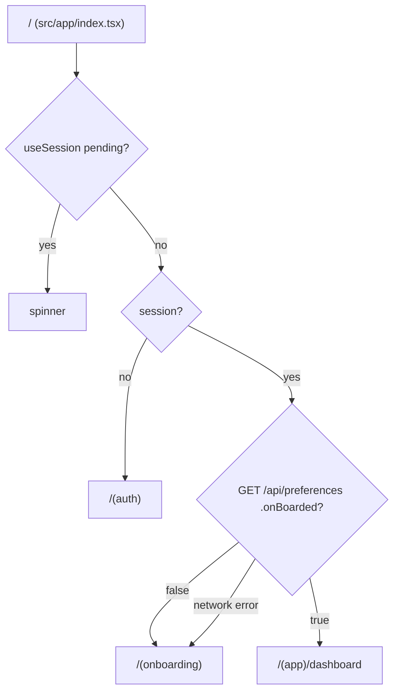

> [!warning] Three screens redirect to a route that **does not exist**
> `app/index.tsx:35`, `(app)/dashboard.tsx:24` and `(app)/activities/[id].tsx:199` all
> `<Redirect href="/(auth)/sign-in" as any} />` — but the only auth route is `auth.tsx`.
> The `as any` casts suppress the `typedRoutes` check that would have caught it.
> In practice the `(app)/_layout` guard redirects to the *correct* `/(auth)/auth` first, so the
> breakage is mostly unreachable — but the `/` entry point is genuinely broken.

### The activity detail bottom sheet

Not a library — a hand-rolled `Animated.View` translated by `translateY` with a Reanimated pan gesture:

| Snap point | `translateY` |
|---|---|
| Expanded | `SCREEN_HEIGHT × 0.08` |
| Half | `SCREEN_HEIGHT × 0.50` |
| Collapsed | `SCREEN_HEIGHT × 0.78` |

- `activeOffsetY([-8, 8])` / `failOffsetX([-16, 16])` — vertical drags claimed, horizontal ones left to the map
- Rubber-band past the extremes: `nextY = EXPANDED_Y + (nextY - EXPANDED_Y) * 0.2`
- Release: `|velocityY| > 400` steps one position; otherwise nearest snap point
- `withSpring(target, { damping: 25, stiffness: 220, mass: 0.8 })`
- Only the handle + athlete header are inside the `GestureDetector`, so the `Animated.ScrollView` below scrolls independently

The map's `boundsPadding` is computed from `HALF_Y` so the route isn't hidden behind the resting sheet.

### Native configuration (`app.json`)

```json
{ "scheme": "mobile", "userInterfaceStyle": "automatic" }
```
- **iOS** `UIBackgroundModes: ["location", "fetch"]` + three location usage strings
- **Android** permissions: `ACCESS_COARSE/FINE/BACKGROUND_LOCATION`, `FOREGROUND_SERVICE(_LOCATION)`, `POST_NOTIFICATIONS`, `RECEIVE_BOOT_COMPLETED`
- `expo-location` plugin with `isAndroidBackgroundLocationEnabled: true` and a foreground-service notification

> [!note] A **dev client** is required
> `android/` is committed prebuild output (no `ios/`). MapLibre Native and background location do not
> work in Expo Go. `apps/mobile/AGENTS.md` is three lines: *"Expo HAS CHANGED. Read the exact versioned
> docs at https://docs.expo.dev/versions/v57.0.0/ before writing any code."*

### Local storage — two unrelated AsyncStorage stores

| Key | Contents | Read by anything? |
|---|---|---|
| `@strava_clone_active_session_v1` | The in-progress recording (full `ActiveSession`) | ✅ yes — `save.tsx` and the hook |
| `@strava_clone_activities_v1` | Archive of saved `ActivitySummary` objects | ❌ **no — write-only** |

Neither is encrypted. `useActivities` keeps a separate **in-memory** module-level cache for the feed.

### Mobile charts (Skia)

`components/charts/ActivityChart.tsx` uses `victory-native` + `@shopify/react-native-skia`.
The interaction readout runs **entirely on the UI thread** — `useDerivedValue` worklets do a
nearest-point linear scan and feed `useAnimatedProps` on an `Animated.TextInput`, so dragging the
chart causes **zero React re-renders**.

`chartMath.ts` constants:
```ts
MAX_POINTS = 500                    // downsample target
GRADE_SMOOTHING_WINDOW = 2          // ±2 → 5-point moving average
GRADE_CLAMP = 50                    // ±50% — beyond is GPS noise
MIN_DIST_FOR_GRADE_M = 0.5          // ignore sub-metre deltas
```
Grade is computed from the **raw metre arrays**, never the converted ones, so the unit choice cannot skew the ratio.

`ChartErrorBoundary` states the failure mode explicitly: *"The native chart views are not available in
this build. Rebuild the app to enable chart rendering."* — i.e. the Skia chart cannot work in Expo Go or web.

---

## 16. `apps/tile-provider` + `@repo/maps` — self-hosted tiles

### The self-hosting decision

> [!important] The default map on **both** platforms is a self-hosted South-India vector tileset
> Not OpenStreetMap. `DEFAULT_TILE_PROVIDER = "southIndia"`, served from
> `apps/tile-provider/data/south-india.mbtiles` (446 MB, committed).

### The data flow

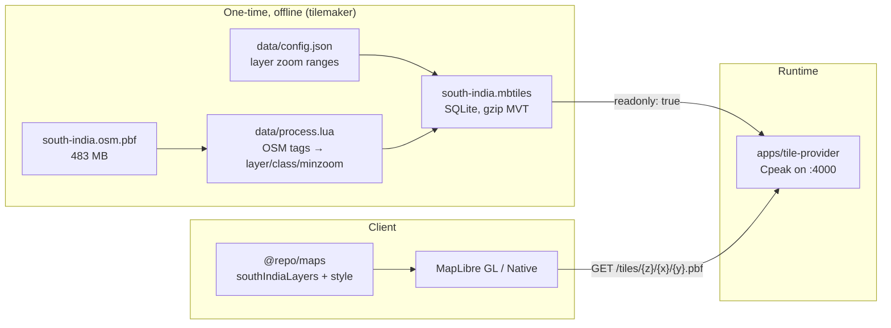

### `@repo/maps` — 3 providers, style builder

| id | type | source | zoom |
|---|---|---|---|
| `openstreetmap` | raster | `https://{s}.tile.openstreetmap.org/{z}/{x}/{y}.png` | max 19 |
| `esriSatellite` | raster | Esri World Imagery — ⚠️ **`{z}/{y}/{x}`**, row before column | max 19 |
| **`southIndia`** ⭐ | **vector** | `${TILE_SERVER_URL}/tiles/{z}/{x}/{y}.pbf` | **4–12** |

`southIndia` carries `bounds: [73.193, 7.812, 81.638, 16.479]` (South India) and
`center: [77.4155, 12.1455, 8]` (≈ Bengaluru, zoom 8).

**`TILE_SERVER_URL` precedence:** `NEXT_PUBLIC_TILE_SERVER_URL` → `EXPO_PUBLIC_TILE_SERVER_URL` →
`http://localhost:4000`, with trailing slashes stripped.

**`TILE_GLYPHS_URL`** is MapLibre's public demo glyph server — MBTiles ships no fonts, so the five
`symbol` layers in the South India style need an external font source.

`southIndia.ts` is a **434-line** hand-written layer stack (13 entries) in a warm "Positron" palette:
background → water/waterway → building → road casing → road fills (zoom-interpolated widths via a
nested `match` on `class`) → road labels → place labels (city/town/village) → POIs. All symbol layers
share a white text halo, `text-allow-overlap: false`, and `symbol-sort-key: coalesce(get("rank"), 100)`.
The layer `source-layer` names and `["get","class"]` reads mirror exactly what `process.lua` emits.

> [!tip] One non-obvious correctness requirement in `adapters/maplibre.ts`
> ```ts
> // tileSize must be ABSENT (not undefined) on a vector source, or MapLibre
> // throws "vector tile sources must have a tileSize of 512" and aborts the
> // style halfway through loading.
> if (provider.type === "raster") source.tileSize = provider.tileSize ?? 256
> ```
> The conditional **assignment** (not the object literal) is the whole point — `extend()` copies own
> enumerable keys, so a present-but-`undefined` key breaks it too.

### `apps/tile-provider` — the server

Cpeak `^2.9.2` (zero-dependency Node HTTP micro-framework), run directly from TS via `tsx`.

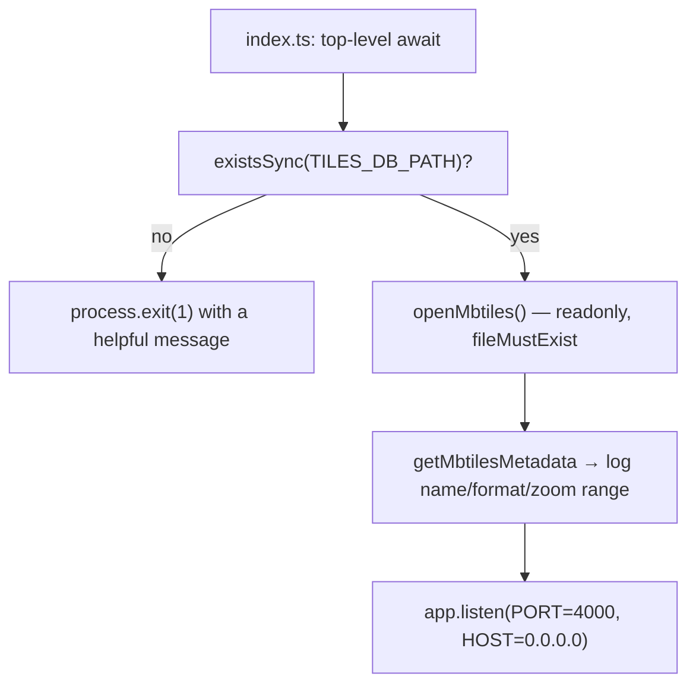

| Endpoint | Response |
|---|---|
| `GET /tiles/:z/:x/:y[.pbf]` | `application/vnd.mapbox-vector-tile` + `content-encoding: gzip`, **ETag = the tile coordinate**, `cache-control: public, max-age=86400, immutable`, **304** on `if-none-match`, `400` with Zod issues, `404` JSON |
| `GET /health` | `{ status, format, minzoom, maxzoom }` |
| `GET /metadata` | the full MBTiles metadata table incl. `vectorLayers` |

All three are unauthenticated and CORS-open for any origin (a single `app.beforeEach(cors())`).

**The two structural gotchas:**
1. **`.pbf` is handled by suffix-stripping inside `parseCoord`, not by a second route.** A Cpeak `:param` matches a whole path segment, so one route answers both forms. *Adding* `/tiles/:z/:x/:y.pbf` would land on the same router node and **throw as a duplicate at boot.**
2. **Raw bytes bypass Cpeak's helpers** — Cpeak has JSON/file/compression helpers but none for raw bytes, so it is `res.setHeader()` + `res.end(buffer)`.

### The XYZ ↔ TMS flip

```ts
// packages/tiles/src/tileId.ts — parameter order is (y, z), NOT (z, y)
export function toStorageRow(y: number, z: number) { return 2 ** z - 1 - y }
```
MBTiles indexes in **TMS** (row 0 at the bottom), while every map client asks in **XYZ** (row 0 at the
top). The spec's own example, quoted in the code: z=11, y=791 → `2^11 - 1 - 791 = 1256`.
**Getting this wrong yields a vertically mirrored map.** There is no inverse function and no test.

> [!note] `packages/tiles` exists as a **library**, not just for this service
> All SQLite + validation logic lives there so `apps/web` and `apps/mobile` can read tiles directly
> later without an HTTP hop. Nothing in the monorepo uses it that way **yet**.

---

## 17. Environment variables

### `apps/web/.env` (copy `.env.example`)

| Var | Read by | Purpose | In `.env.example`? |
|---|---|---|---|
| `DATABASE_URL` | `packages/db/src/db.ts` | Pooled Postgres (Neon). **The only var the Next build needs.** | ✅ |
| `DATABASE_URL_DIRECT` | `drizzle.config.ts` only | Unpooled connection for migrations (DDL) | ✅ |
| `BETTER_AUTH_SECRET` | Better Auth implicitly | Signs session tokens | ✅ |
| `BETTER_AUTH_URL` | Better Auth implicitly | Canonical origin → cookie domain/secure | ✅ |
| `NEXT_PUBLIC_TILE_SERVER_URL` | `packages/maps/src/tileServer.ts` | Base URL of the tile service | ✅ |
| `CLEINT_ID` | `lib/auth.ts` | Google OAuth client id — ⚠️ **misspelled** | ✅ |
| `CLEINT_SECRET` | `lib/auth.ts` | Google OAuth client secret — ⚠️ **misspelled** | ✅ |
| `EXPO_PUBLIC_API_URL` | `lib/auth.ts` `trustedOrigins` | Expo app's API base. **Must match the mobile client's `baseURL` or mobile auth fails cross-origin.** | ❌ |
| `NEXT_PUBLIC_BETTER_AUTH_URL` | `lib/auth-client.ts` | Browser auth base. Falls back to page origin if unset. | ❌ |

### `apps/mobile/.env`

| Var | Read by |
|---|---|
| `EXPO_PUBLIC_API_URL` | `lib/auth-client.ts`, `app/index.tsx`, `useActivities`, `useOnboarding`, `useActivityRecorder`, `activities/[id]`, `ActivityFeed`, `upload/manual` |
| `EXPO_PUBLIC_TILE_SERVER_URL` | `packages/maps/src/tileServer.ts` (the web var also works as a fallback) |

### `apps/tile-provider/.env`

| Var | Default | Notes |
|---|---|---|
| `PORT` | `4000` | A malformed value **silently** falls back to 4000 (no Zod validation) |
| `HOST` | `0.0.0.0` | |
| `TILES_DB_PATH` | `data/tiles.mbtiles` | ⚠️ **the default is wrong in practice** — the committed file is `data/south-india.mbtiles`, so booting without a `.env` exits with the "No tileset at …" error |

> [!danger] Secrets hygiene
> `apps/web/.env` on disk contains a live Postgres password, a live `BETTER_AUTH_SECRET`, and a live
> Google OAuth secret. It **is** gitignored (root + `apps/web/.gitignore`), but if this workspace has
> ever been synced to a cloud IDE or copied into a container layer, rotate them and verify with
> `git log --all -- apps/web/.env`.

---

## 18. Commands & tooling

### Root (`package.json`)

| Command | Runs |
|---|---|
| `pnpm dev` | web + mobile + tile-provider **in parallel** |
| `pnpm web` | `pnpm --filter web dev` → `next dev --webpack` |
| `pnpm app` | `pnpm --filter mobile dev` → `expo start` |
| `pnpm app:android` | `pnpm --filter mobile android` → prebuild + `run:android` (dev client) |
| `pnpm tiles` | `pnpm --filter tile_provider dev` → `tsx watch src/index.ts` |
| `pnpm lint` | `biome lint` (the only real linter) |
| `pnpm dbg` / `dbm` / `dbp` | `drizzle-kit generate` / `migrate` / `push` |
| `pnpm test` | deliberately exits 1 — **no tests exist** |

> [!note] Naming inconsistency
> The directory and package are `apps/tile-provider` / `tile-provider`, but the filter is
> `tile_provider` and `packages/maps` refers to it as `@repo/tile_provider` in a comment.
> pnpm matches the underscore form, so `pnpm tiles` works — but don't be surprised.

### Local dev order

1. `pnpm dbm` (or `dbp`) — apply migrations to Postgres
2. `pnpm tiles` — the map needs a tile server on `:4000`
3. `pnpm web` — API + web on `:3000`
4. `pnpm app:android` — the mobile app needs `EXPO_PUBLIC_API_URL` pointing at your **LAN** IP, not `localhost`

### Linting

```bash
pnpm lint                                  # biome (tabs, double quotes, recommended rules)
cd apps/web && pnpm lint                   # eslint (eslint-config-next) — declared but not the gate
npx biome check --write .                  # format + autofix
```

---

## 19. Deployment

`Dockerfile` — 3 stages, `node:22-alpine`:

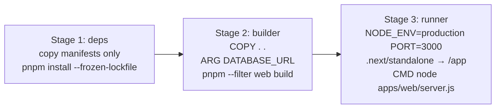

- `output: "standalone"` in `next.config.ts` is what makes stage 3's 2-line `COPY` possible.
- `DATABASE_URL` is passed as a build `ARG` — the only env var Next needs at build time.

> [!warning] Stage 1 only copies **3** of the 12 workspace manifests
> ```dockerfile
> COPY apps/web/package.json        ./apps/web/
> COPY packages/db/package.json     ./packages/db/
> COPY packages/validation/package.json ./packages/validation/
> ```
> `pnpm-workspace.yaml` globs `apps/*` and `packages/*`, so at install time pnpm sees only those
> three — `@repo/gpx`, `@repo/maps`, `@repo/units`, `@repo/types`, `@repo/tiles` and the whole
> `apps/mobile` + `apps/tile-provider` trees are absent, and their `node_modules` symlinks are never
> created. Stage 2's `COPY . .` restores the *source* but not the *install*. **Verify the Docker
> build actually runs** before trusting it; adding manifests is cheap and harmless.
>
> Also note `.dockerignore` excludes `**/drizzle`, so **migrations never reach the image** — they are
> run out-of-band with `pnpm dbm` against `DATABASE_URL_DIRECT`.

Only `apps/web` is containerised. `apps/mobile` ships via EAS (`f2e55542-…`, owner `redstonenights-team`); `apps/tile-provider` has no deployment story yet.

---

## 20. Invariants — do not break these

> [!danger] If you only read one section, read this one
> These are the properties the codebase is built around. Violating any of them produces subtly wrong
> data rather than a crash.

1. **Storage units are integer metres and integer seconds.** `distance`, `duration`, `elevationGain`, `elevationLoss` are all `integer` columns. Convert for display, never for storage.
2. **`userId` for writes comes from the session, never from the request body.** This is the one place ownership is enforced at creation.
3. **Every normalizer must return `NormalizedActivityData`**, and must use the `to*` coercion helpers so `NaN` / `Invalid Date` can never reach Postgres.
4. **Any error other than `ZodError` / `NormalizationError` is a server bug** — rethrow it to get a 500. Do not launder server faults into user-facing validation errors.
5. **Stats and streams come from RAW points; only the polyline is simplified.** Do not "optimize" by simplifying before computing.
6. **Activity + streams are written in ONE transaction** (`CreateActivity`). The legacy `CreateActivityFromGpx` + `CreateActivityStreams` pair does not, and can leave an orphan.
7. **Polyline precision is 1e-5 and the format is Google Encoded Polyline v1.** Anything that changes it invalidates every stored `encoded_polyline`.
8. **XP/coord conversion at the boundary only.** `ActivityPoint.latitude` → `RawTrackpoint.lat` happens in exactly one place per normalizer.
9. **The active session in AsyncStorage is the source of truth**; the hook is a projection of it. Never compute distance in the hook.
10. **The background task both persists AND fans out.** If you split these, live UI updates and crash recovery break in different ways.
11. **Packages ship raw TS.** Adding a `build` step to any `packages/*` is a significant architectural change.
12. **`tileSize` must be absent on vector sources** (not `undefined`).
13. **MBTiles rows are TMS.** `toStorageRow(y, z)` — argument order is `(y, z)`.

---

## 21. Known gaps, bugs & sharp edges

> [!warning] Documented deliberately so you don't rediscover them
> These were found by reading the code, not reported by users.

### 🔴 Security

| Issue | Where | Detail |
|---|---|---|
| **IDOR on activity list** | `api/activities/route.ts` GET | `userId` comes from the **query string**; the session is checked for *existence* but never compared. `GET /api/activities?userId=<anyone>&limit=1000` returns another user's full activities including GPS traces. The mobile client uses this exact call shape, so the fix must keep it working. **Derive from `session.user.id`.** |
| **IDOR on activity read** | `api/activities/[id]/route.ts` GET | `activityId` from the URL; `activity.userId` never compared. `DELETE` does this correctly. |
| **Mass assignment** | `api/preferences/route.ts` PATCH | No Zod; `{...body}` is spread into the DB update. Only `userId` is pinned back to the session. |
| **Error leakage** | `api/activities/route.ts` GET | `NextResponse.json({ error: err }, …)` serialises the **raw thrown error**, including stack/DB detail. |
| **12 MB cap is bypassable** | `api/activities/route.ts` POST | A `Content-Length`-less (chunked) request yields `0`, which is finite and under the cap. |
| **Open redirect** | `app/auth/page.tsx` | OAuth `callbackURL` from the query is not sanitised. |
| **`DeleteActivity`'s optional `userId`** | `packages/db` | Omit the argument and any caller can delete any activity. There is no RLS behind it. |

### 🟠 Correctness

| Issue | Where | Detail |
|---|---|---|
| **Crash on missing preferences** | `activities/[id]/page.tsx` | `data.user.preferences.distanceUnit` throws if the user has no `user_preferences` row. `/dashboard` self-heals via `createUserPreferences`, but a user following a shared link straight to `/activities/[id]` gets a 500. |
| **Hardcoded pace unit** | `activities/[id]/page.tsx` | `computePace(duration, distance, "min/km")` is combined with the user's `paceUnit` label — an imperial user sees a kilometre-derived number labelled `min/mi`. It should be `formatPace(..., data.user.preferences.paceUnit)`. **The card component gets this right; the detail page does not.** |
| **Broken mobile redirects** | `app/index.tsx`, `dashboard.tsx`, `[id].tsx` | `/(auth)/sign-in` does not exist (it's `/(auth)/auth`). `as any` casts hide it from `typedRoutes`. |
| **Silent sync failure** | `useActivityRecorder.saveRecordedActivity` | Server POST failure is `console.warn`-ed and forgotten. No retry queue, no outbox. |
| **`formatPace` can print `"5:60"`** | `@repo/units/pace` | Rounding to 2 dp then `Math.round((pace - mins) * 60)` can yield 60; seconds are never wrapped. |
| **UTC vs local formatter disagreement** | `@repo/units/timestamp` | `toDateAndTime` uses `toISOString()` (UTC); `formatDateAndTime` uses local methods. |
| **`altitudeData` plots missing elevation at 0** | `packages/gpx/src/streams.ts` | `p.ele ?? 0`, while `computeElevation` correctly *skips* nulls. Inconsistent. |
| **Un-timestamped GPX produces a nonsense time axis** | `packages/gpx/src/streams.ts` | `timeData[i] = i` (the index) when a point has no timestamp, mixed into an array otherwise measured in seconds. |
| **Route zoom mismatch** | `providers.ts` vs `data/config.json` | The provider declares `maxZoom: 12` but the tileset contains z13–14 detail (buildings, POIs, paths). MapLibre never requests it. |
| **Default `TILES_DB_PATH` is wrong** | `apps/tile-provider/src/env.ts` | Defaults to `data/tiles.mbtiles`; the committed file is `data/south-india.mbtiles`. |
| **Migration 0004 not backfill-safe** | `drizzle/0004_*.sql` | The `text → enum` cast aborts if any row has a `type` outside the five labels. |

### 🟡 Dead code & drift

| Item | Where |
|---|---|
| `@repo/maps` missing from `transpilePackages` | `next.config.ts` — masked by `dev --webpack`. **Removing `--webpack` will break the build.** |
| Commented-out speed chart references `LineChart`/`Line` which are **not imported** | `charts/ActivityChart.tsx:154` — un-commenting will not compile. |
| `lat`/`lng` arrays built then discarded | `packages/gpx/src/streams.ts` — dead work on every call. |
| `MetaDataSchema` exported, zero call sites | `packages/validation` |
| `getSavedActivitiesLocally` — write-only archive | `apps/mobile/src/lib/activityStorage.ts` |
| `preferences.theme` collected, stored, never applied | see [[#14. `apps/web` — routes, data fetching, components]] |
| Navbar search → `?search=` that `dashboard/page.tsx` never reads | `components/Navbar.tsx:103` |
| `selectedRoute` state in the recorder is never used | `recorder/recorder.tsx` |
| The recorder's `3D` toggle only changes a button colour | `is3dMode` is never passed to `MapView` |
| `segments` / `best_efforts` tabs are hardcoded static cards | mobile `TabViews.tsx` |
| `formatErrorMessage` duplicated verbatim (~35 lines) | `upload/{file,manual}/page.tsx` |
| Three different `SPORTS` lists (recorder: 3, save: 4, manual: 5) | mobile |
| Two different "default" preference objects | `useOnboarding.DEFAULT_PREFS` (`system`/`24h`) vs `ActivityFeed.DEFAULT_PREFERENCES` (`light`/`12h`) |
| `proxy.ts`'s `callbackUrl` drops the query string | deep-linked searches silently lose `?search=` |
| `ActivityPoint.speed`/`accuracy` are validated then discarded | mobile normalizer drops them |
| `movingTimeSeconds` / `avgSpeedMps` accepted and never persisted | `MobileActivitySchema` |
| Unit string unions declared 2–3 times independently | `@repo/units/types.ts` vs DB enums vs `MetaDataSchema` |
| `UnitPreferences`, `MetaDataType`, `tilesType`, `metadataType` exported, never used | various |
| `/activities` is a dead-end placeholder the Navbar links to | `app/activities/page.tsx` |
| Typos: "Upload Activitiy", `CLEINT_ID`, `ActivtyCard.tsx` | various |

### 🟠 Performance

- **Zero indexes in the entire schema.** Every activity list is a sequential scan + sort.
- **Offset pagination** (`LIMIT/OFFSET`) degrades linearly with page depth.
- **No server-side caching** on the RSC pages — every navigation is a full DB round-trip.
- **`getActivityDetails` issues 4 separate statements** (activity, streams, user, preferences), not one JOIN.

---

## 22. Glossary

| Term | Meaning here |
|---|---|
| **Activity** | One recorded/uploaded/typed workout. The central entity. |
| **Source** | Where an activity came from: `"mobile" \| "gpx" \| "manual"`. |
| **Normalization** | Converting a source-specific payload into `NormalizedActivityData`. |
| **RawTrackpoint** | Internal point shape: `{ lat, lng, ele, time }`. |
| **ActivityPoint** | Client-facing point shape: `{ latitude, longitude, altitude, speed, accuracy, timestamp }`. |
| **Stream** | One of four parallel `number[]` arrays (`time`, `distance`, `altitude`, `speed`) powering the charts. |
| **Polyline** | Google Encoded Polyline v1 string; **the only stored geometry**. |
| **Simplification** | Douglas-Peucker, ε = 0.0001 (≈ 10 m). Applied to the polyline only. |
| **Canonical units** | Integer metres, integer seconds, `real` m/s. |
| **Haversine** | Great-circle distance between two coordinates; R = 6 371 000 m. |
| **Dead-band** | The 2 m threshold below which an elevation step is discarded entirely. |
| **Projection** | The hook's React state being a view of the AsyncStorage session. |
| **ETag-as-coordinate** | The tile server uses `"z/x/y"` as the ETag — valid because the tileset is immutable. |
| **XYZ vs TMS** | Tile row axis direction. MBTiles stores TMS; map clients ask for XYZ. |
| **MBTiles** | A SQLite file holding a pre-rendered tile pyramid (+ metadata). |
| **Vector tile (MVT/pbf)** | Compact binary vector geometry per tile, gzip-compressed. |
| **`db.query` vs `db.select`** | Drizzle's relational API (follows `with:`, needs the `schema` passed to `drizzle()`) vs the core query builder. |
| **`$inferSelect` / `$inferInsert`** | Drizzle's type derivation from a table definition. |
| **`$onUpdate`** | Drizzle-Kit feature that bumps a timestamp column on update (not a Postgres `ON UPDATE`). |
| **`proxy.ts`** | Next 16's rename of `middleware.ts`. |
| **RSC** | React Server Component. Runs on the server, can query the DB directly. |
| **`proxy` (the pattern)** | A tiny closure component passed as a Server Action prop. |
| **`$fetch`** | Better Auth's fetch wrapper — serializes the body and attaches the session automatically. |
| **`as any` on a href** | Silences `typedRoutes`; a common source of broken mobile navigation. |
| **Dev client** | An Expo build with native modules — required for MapLibre Native + background location. |

---

## 23. File index — "where do I look?"

### "How does an activity get created?"

| # | File | Why |
|---|---|---|
| 1 | `apps/web/app/api/activities/route.ts` | The gate: auth, size cap, source dispatch, error taxonomy |
| 2 | `apps/web/lib/normalization/index.ts` | The barrel |
| 3 | `apps/web/lib/normalization/{gpx,manual,mobile}.ts` | The three normalizers |
| 4 | `apps/web/lib/normalization/shared.ts` | `NormalizedActivityData` + coercion helpers |
| 5 | `packages/validation/src/zodSchema.ts` | The input contract |
| 6 | `packages/gpx/src/{parser,verify,haversine,simplify,polyline,stats,streams}.ts` | The math |
| 7 | `packages/db/src/queries/activities.ts` | `CreateActivity` — the transaction |

### "How does the map work?"

| Concern | File |
|---|---|
| Style / layer stack | `packages/maps/src/styles/southIndia.ts` |
| Provider registry + default | `packages/maps/src/providers.ts` |
| Style builder (source + layers) | `packages/maps/src/adapters/maplibre.ts` |
| Tile server URL resolution | `packages/maps/src/tileServer.ts` |
| Web map (MapLibre GL JS) | `apps/web/components/map/MapClient.tsx` |
| Mobile map (MapLibre Native) | `apps/mobile/src/components/map/Map.tsx` |
| Tile HTTP service | `apps/tile-provider/src/routes/tiles.ts` |
| XYZ↔TMS | `packages/tiles/src/tileId.ts` |
| Tileset build inputs | `apps/tile-provider/data/{config.json,process.lua}` |

### "How does recording work?"

| # | File | Why |
|---|---|---|
| 1 | `apps/mobile/src/lib/locationTask.ts` | The native background task + pub/sub |
| 2 | `apps/mobile/src/lib/activeSessionStorage.ts` | The session object, buffering, distance math, pause |
| 3 | `apps/mobile/src/hooks/useActivityRecorder.ts` | The React state machine |
| 4 | `apps/mobile/src/app/(app)/recorder/recorder.tsx` | The screen |
| 5 | `apps/mobile/src/app/(app)/recorder/save.tsx` | Review + save |
| 6 | `apps/web/lib/normalization/mobile.ts` | The server side of the same activity |

### "How does auth work?"

| Concern | File |
|---|---|
| Server config | `apps/web/lib/auth.ts` |
| Better Auth mount | `apps/web/app/api/auth/[...all]/route.ts` |
| Web client | `apps/web/lib/auth-client.ts` |
| Web sign-in UI | `apps/web/app/auth/page.tsx` |
| Route gating | `apps/web/proxy.ts` |
| Mobile client + SecureStore + staleness logic | `apps/mobile/src/lib/auth-client.ts` |
| Mobile auth UI | `apps/mobile/src/app/(auth)/auth.tsx` |
| Mobile gate | `apps/mobile/src/app/index.tsx` + `(app)/_layout.tsx` |
| Tables | `packages/db/src/schema.ts` (`user`, `session`, `account`, `verification`) |

### "Where are the preferences / units formatted?"

| Concern | File |
|---|---|
| Storage + schema | `packages/db/src/schema.ts` → `user_preferences` |
| Queries | `packages/db/src/queries/preferences.ts` |
| API | `apps/web/app/api/preferences/route.ts` |
| Onboarding (web) | `apps/web/app/onboarding/page.tsx` + `components/onBoardingUI/` |
| Onboarding (mobile) | `apps/mobile/src/app/(onboarding)/index.tsx` + `hooks/useOnboarding.ts` |
| **All conversions & formatting** | `packages/units/src/*` — the single place to look |
| Username API | `apps/web/app/api/user/route.ts` |

### "What should I read to understand the data model?"

1. `packages/db/src/schema.ts` — every table, column, enum, and relation
2. `packages/db/drizzle/*.sql` — the five migrations in order
3. `packages/db/src/queries/*.ts` — how rows are actually read and written
4. `apps/web/lib/normalization/shared.ts` — the canonical shape the DB is fed
5. `packages/types/src/*.ts` — the DTOs shared with the client

---

> [!tip] Keeping this document alive
> - When you add a package, a table, or a source → update §4, §5, §6.
> - When you add an invariant → add it to §20. That section is the highest-value part.
> - When you find a new sharp edge → §21. Future-you will be grateful.
> - Cross-link aggressively. Every "see §N" is a link you can follow without leaving Obsidian.

---

<div align="center">

*Strava Clone — System Map · living document · keep in sync with the code*

</div>
